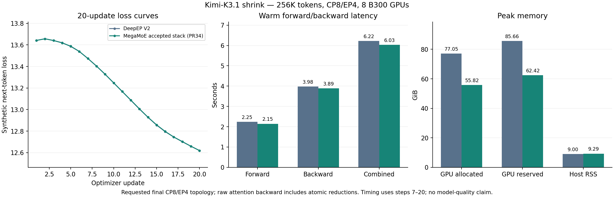
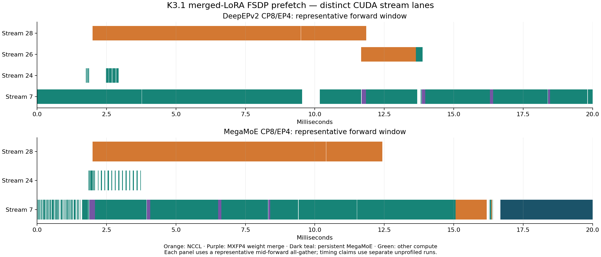

# Kimi-K3.1 merged-LoRA: final 256K CP8/EP4 comparison

The complete accepted MegaMoE stack and DeepEPv2 each completed 20 optimizer updates on eight B300 GPUs. This compares the whole stack against DeepEPv2; it does not isolate PR #34's contribution. The historical backward target remains unmet.

| Metric | DeepEPv2 | MegaMoE |
|---|---:|---:|
| Forward, ms | 2246.382 | 2146.166 |
| Backward, ms | 3978.951 | 3887.422 |
| Combined, ms | 6222.144 | 6028.643 |
| Peak GPU allocated, GiB | 77.054 | 55.817 |
| Peak GPU reserved, GiB | 85.664 | 62.424 |
| Peak host RSS, GiB | 8.996 | 9.293 |
| Peak driver pinned, MiB | 17.337 | 3.985 |

Speedups are 1.0467x forward, 1.0235x backward and 1.0321x combined. Allocated GPU memory decreases 27.56%; host RSS increases 3.31%. Timing is the median per-step maximum-rank observation over updates 7–20, without the profiler. Combined medians are independently measured. Memory values are maxima across all updates and ranks, per process; they do not sum workers or compiler/MPS helpers. Pinned instrumentation reports zero errors.

## Configuration and provenance

- Existing `kimi_k31 / k31_shrink` YAML, 262144 tokens, CP8/EP4, DP shard 1, LoRA rank/alpha 32, full activation checkpointing, input offload disabled, pipelined/chunked optimizer offload, SPAG CP attention.
- Same checkpoint and seeded synthetic next-token data, seed 42. Both arms use native MXFP4 base weights with merged BF16 expert execution. This is a training integration check, not a model-quality evaluation.
- Fireworks consumer: `aa0cd94de7ecea5c07b121a5f94f74967825177e`.
- Native code: `85b09fdf70a57d2bd59aeebd95631a0657413845`; tested package/evidence head: `251ddd051d3d295a1ba237c56af86fd05f187f07`. Subsequent CP8 documentation commits do not change the native source or tested package.
- Image: `codex-kda-eager-cache:20261015`, SHA `c18337a5b24f653f6e079dab7a3fe4f1753cc1b27708e2f1b38a156efac93b1c`; PyTorch 2.11/CUDA 13.

Initial loss is 13.6416168213 for both arms. Final loss is 12.6196050644 for DeepEPv2 and 12.6196994781 for MegaMoE. The largest absolute difference is 0.0020847321. Every loss is finite and every optimizer update succeeded. Production attention backward uses atomic reductions: these curves do not prove strict whole-model gradient equivalence. Separate kernel/score cosine, repeated-forward, corner-length/no-recompile and CP/checkpoint/offload qualification remains in the accepted kernel bundle.

## LoRA prefetch

The actual `layers.N._checkpoint_wrapped_module.moe.experts` owners are prefetched. Ranks 0/4, covering both EP groups, were analyzed on capture steps 5/6: four traces per backend, each with 15 forward and 14 backward prefetched expert all-gathers.

| Fraction of prefetched expert all-gather duration overlapping non-NCCL compute | DeepEPv2 | MegaMoE |
|---|---:|---:|
| Forward, range across four traces | 96.74–98.11% | 99.34–99.44% |
| Backward, range across four traces | 72.37–75.09% | 98.83–98.98% |

These are observed timeline intersections, not bandwidth-efficiency or critical-path savings estimates. All-gathers overlap surrounding compute; their measured intersection with persistent MegaMoE grids is zero. FSDP all-gather overlap does not quantify the expert all-to-all communication inside MegaMoE.

## Capture integrity and publication

The separate six-update capture per backend has four warmups and captures updates 5/6 on all eight ranks. All 32 compressed traces parse and all 32 allocator snapshots load. Capture ownership contains no foreign or unknown observations. Timing has 594 observations with no foreign workload; one vanished worker during teardown is reconciled from 286 prior owned observations after all update files were written. Raw records and the hash-bound reconciliation are preserved. One-second sampling does not guarantee ownership at unobserved instants.

The frozen local bundle `profile/k31-megamoe-final-prelude-pairs-cp8-20261028` contains 227 payload files totaling 6,692,788,042 bytes plus its SHA256 manifest. Raw timing, traces, snapshots, configurations, commands, ownership records and analyzers are included. The JSON alongside this document is copied exactly from its final timing summary.

GCS destination: `gs://fireworks-fine-tuning-profiles/kimi-k31/yued/20261027-megamoe-merged-lora/final-prelude-pairs-cp8-256k/`.

**Upload pending as of 2026-10-28:** the access check fails with expired/revoked credentials. The final CP8 GCS destination is not claimed as published. Existing isolated kernel evidence remains verified at `prelude-adjacent-pairs-ep2-ep4/` under the same prefix.

No production source changes accompany this evidence update. The native optimization adds no Python calls, kernel launches, allocations or synchronization phases; it preserves the existing prelude launch and barriers.
